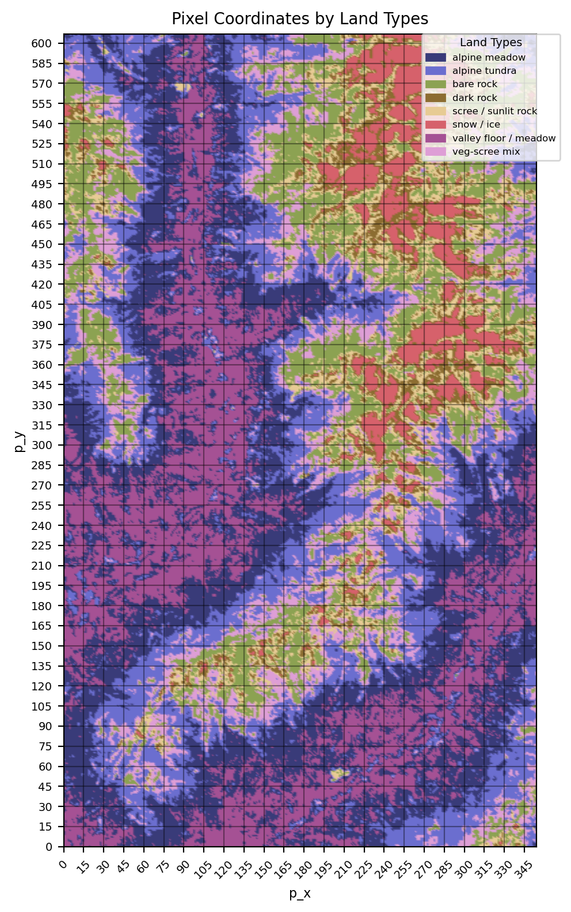
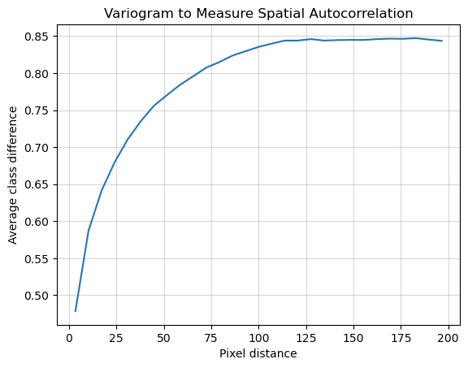
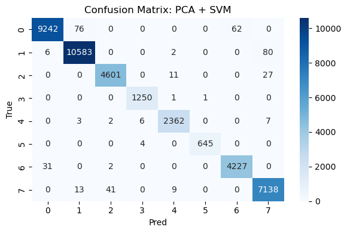

# Hyperspectral Land Classification

A geospatial machine learning project using **EnMAP hyperspectral satellite imagery** to classify vegetation types in the Tyrol region of Austria. The analysis focuses on high-dimensional spectral data, spatial dependence, dimensionality reduction, and robust model evaluation.

The work was completed as part of **ST443 at the London School of Economics**.

## My contribution

I led **Task 1: hyperspectral satellite image classification**, including the geospatial exploratory analysis, model comparison, spatial validation strategy, PCA experiments, and interpretation of the classification results.

The overall project was developed collaboratively. I also contributed to the **methodological discussions, modelling choices, and interpretation of results** for Task 2, which focused on feature selection in high-dimensional neural data. The implementation of that second task was led primarily by another member of the group.

## Problem

The dataset contains EnMAP hyperspectral imagery from an alpine region in Tyrol, Austria. Each pixel is described by:

- **218 spectral bands** spanning 420–2450 nm
- spatial coordinates (`p_x`, `p_y`)
- one of **eight vegetation / land-cover classes**

The executed notebook contains **215,604 pixel observations**.

The goal is to predict the vegetation class of each pixel from its spectral signature while accounting for the fact that nearby observations are not independent.

## Why the spatial structure matters

A key challenge is **spatial autocorrelation**: pixels close to one another often belong to the same landscape patch and therefore have similar labels and spectral profiles.

A purely random train/test split could place neighbouring pixels from the same geographic area in both sets, making test performance look unrealistically strong. To reduce this leakage risk, the analysis constructs **spatial blocks** and holds out entire blocks during evaluation.



The variogram-style analysis below illustrates the spatial dependence in the labels:



## Methods

For the hyperspectral classification task, I compared a broad set of classical statistical-learning and machine-learning models:

- Linear Discriminant Analysis
- Logistic Regression
- Quadratic Discriminant Analysis
- k-Nearest Neighbours
- Random Forest
- Gradient Boosted Trees / XGBoost
- Support Vector Machines

Because the raw data contains 218 highly correlated spectral bands, I also repeated the modelling pipeline after reducing the feature space to **10 principal components with PCA**.

The workflow additionally includes:

- exploratory analysis of spectral and spatial structure
- correlation-based hierarchical clustering of spectral bands
- class-imbalance-aware metrics
- grouped cross-validation based on spatial blocks
- comparison of full-spectrum and PCA-based models

## Evaluation

Models are compared using several complementary metrics:

- overall misclassification rate
- confusion matrix
- average balanced accuracy
- average AUC
- average F1 score

Balanced accuracy is especially useful here because the eight vegetation classes are not equally represented.

## Selected results

The strongest model in the executed notebook was an **RBF-SVM after PCA**, evaluated on spatially held-out blocks.

| Model | Balanced accuracy | Weighted F1 | AUC |
|---|---:|---:|---:|
| PCA + RBF-SVM | **0.992** | **0.991** | **1.000** |
| PCA + Logistic Regression | 0.985 | 0.988 | 1.000 |
| PCA + k-NN | 0.971 | 0.971 | 1.000 |
| Random Forest | 0.963 | 0.958 | 0.999 |
| XGBoost | 0.960 | 0.957 | 0.999 |

One useful result was that PCA was **not uniformly beneficial**. It substantially improved SVM and logistic regression, while some tree-based methods performed better using the original spectral features. This highlighted that dimensionality reduction should be evaluated as part of the modelling pipeline rather than assumed to help every algorithm.



## Second project task: neural feature selection

The original group project also investigated a second high-dimensional learning problem: predicting a binary behavioural choice from neural spike-count data containing thousands of candidate features.

I contributed to the **discussion of modelling strategy, feature-selection decisions, evaluation design, and interpretation of the results**. The implementation of this task was led primarily by another team member, so it is included here as part of the full group-project context rather than presented as my main technical contribution.

The code for this task is available in `neural_feature_selection.py`.

## Repository structure

```text
.
├── hyperspectral_land_cover_classification.ipynb   # Task 1 - led by me
├── neural_feature_selection.py                     # Task 2 - collaborative group work
├── assets/
│   ├── land_cover_spatial_distribution.png
│   ├── spatial_autocorrelation_variogram.png
│   └── pca_svm_evaluation.png
├── data/
│   └── README.md
├── requirements.txt
└── README.md
```

## Setup

```bash
python -m venv .venv
source .venv/bin/activate
pip install -r requirements.txt
```

Download / place the dataset as described in [`data/README.md`](data/README.md), then run:

```bash
jupyter notebook hyperspectral_land_cover_classification.ipynb
```

## Contributors

Group project by:

- Daniel Hogan
- Lorenzo Ravera
- George Boutselis
- Jun Han Ng

## Notes

The original coursework datasets are not redistributed in this repository. The code and notebook are preserved as the final project implementation, with repository structure and documentation cleaned for public presentation.
